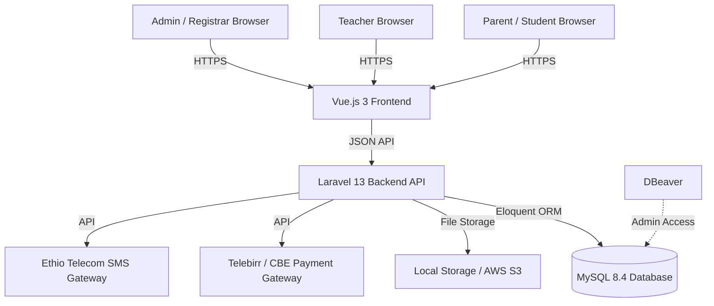

# System Architecture
## Smart School Management System (Smart SMS)

**Project Name:** Smart SMS
**Author:** Werkyantfu
**Date:** October 2026

---

## 1. High-Level Architecture

The system follows a **Client-Server Architecture** using a Single Page Application (SPA) approach. The Vue.js frontend communicates with the Laravel backend via RESTful APIs.



---

## 2. Technology Stack

### 2.1 Frontend (Client-Side)
- **Framework:** Vue.js 3 (Composition API)
- **Build Tool:** Vite
- **Styling:** Tailwind CSS (Responsive Design)
- **State Management:** Pinia
- **Routing:** Vue Router
- **HTTP Client:** Axios

### 2.2 Backend (Server-Side)
- **Framework:** Laravel 13 (PHP 8.5)
- **Authentication:** Laravel Sanctum (API Tokens)
- **Authorization:** Role-Based Access Control (RBAC) using Spatie Package
- **Architecture:** MVC + Service Layer

### 2.3 Database & Infrastructure
- **Database:** MySQL 8.4
- **DB Management:** DBeaver
- **Server OS:** Ubuntu 24.04 LTS
- **Web Server:** Nginx + PHP-FPM

---

## 3. Data Flow

1. User logs in via Vue.js (Frontend).
2. Axios sends credentials to `/api/login`.
3. Laravel validates and returns a **Bearer Token**.
4. Vue stores the token and attaches it to every subsequent request.
5. Laravel verifies the token and role permissions before processing the request.
6. Data is fetched from MySQL and returned as JSON.
7. Vue updates the UI seamlessly without reloading the page.

---

## 4. Security Measures

- **HTTPS:** All traffic is encrypted via SSL/TLS.
- **Password Hashing:** bcrypt algorithm.
- **Role-Based Access Control (RBAC):** Parents cannot access Admin routes.
- **Input Validation:** Backend validates all forms to prevent SQL Injection and XSS.
- **Database Backups:** Automated daily backups via cron jobs.# API Endpoints
## Smart SMS Backend

**Base URL:** `http://localhost:8000/api`

| Method | Endpoint | Description | Auth Role | Payload Example |
|--------|----------|-------------|-----------|-----------------|
| **POST** | `/login` | User login | Public | `{ "email": "...", "password": "..." }` |
| **POST** | `/logout` | User logout | Any Auth | None |
| **GET** | `/students` | List all students | Admin, Registrar | None |
| **POST** | `/students` | Create new student | Admin, Registrar | `{ "first_name": "Abebe", "last_name": "Kebede", "class_id": 1 }` |
| **GET** | `/students/{id}` | Get single student | Admin, Teacher, Parent | None |
| **PUT** | `/students/{id}` | Update student data | Admin, Registrar | `{ "guardian_phone": "0911..." }` |
| **POST** | `/invoices` | Generate invoice | Accountant | `{ "student_id": 1, "amount": 5000 }` |
| **POST** | `/payments` | Record payment | Accountant | `{ "invoice_id": 1, "amount": 5000, "method": "telebirr" }` |
| **POST** | `/marks` | Enter student marks | Teacher | `{ "student_id": 1, "subject_id": 2, "score": 85 }` |
| **GET** | `/report-cards/{id}` | Generate report card | Parent, Admin | None (Returns PDF) |

### Sample JSON Response: `GET /students`

```json
{
  "data": [
    {
      "id": 1,
      "student_id_number": "SMS-2026-0001",
      "first_name": "Abebe",
      "last_name": "Kebede",
      "class": {
        "id": 1,
        "name": "Grade 1"
      },
      "status": "active"
    }
  ]
}# API Endpoints
## Smart SMS Backend

**Base URL:** `http://localhost:8000/api`

| Method | Endpoint | Description | Auth Role | Payload Example |
|--------|----------|-------------|-----------|-----------------|
| **POST** | `/login` | User login | Public | `{ "email": "...", "password": "..." }` |
| **POST** | `/logout` | User logout | Any Auth | None |
| **GET** | `/students` | List all students | Admin, Registrar | None |
| **POST** | `/students` | Create new student | Admin, Registrar | `{ "first_name": "Abebe", "last_name": "Kebede", "class_id": 1 }` |
| **GET** | `/students/{id}` | Get single student | Admin, Teacher, Parent | None |
| **PUT** | `/students/{id}` | Update student data | Admin, Registrar | `{ "guardian_phone": "0911..." }` |
| **POST** | `/invoices` | Generate invoice | Accountant | `{ "student_id": 1, "amount": 5000 }` |
| **POST** | `/payments` | Record payment | Accountant | `{ "invoice_id": 1, "amount": 5000, "method": "telebirr" }` |
| **POST** | `/marks` | Enter student marks | Teacher | `{ "student_id": 1, "subject_id": 2, "score": 85 }` |
| **GET** | `/report-cards/{id}` | Generate report card | Parent, Admin | None (Returns PDF) |

### Sample JSON Response: `GET /students`

```json
{
  "data": [
    {
      "id": 1,
      "student_id_number": "SMS-2026-0001",
      "first_name": "Abebe",
      "last_name": "Kebede",
      "class": {
        "id": 1,
        "name": "Grade 1"
      },
      "status": "active"
    }
  ]
}# API Endpoints
## Smart SMS Backend

**Base URL:** `http://localhost:8000/api`

| Method | Endpoint | Description | Auth Role | Payload Example |
|--------|----------|-------------|-----------|-----------------|
| **POST** | `/login` | User login | Public | `{ "email": "...", "password": "..." }` |
| **POST** | `/logout` | User logout | Any Auth | None |
| **GET** | `/students` | List all students | Admin, Registrar | None |
| **POST** | `/students` | Create new student | Admin, Registrar | `{ "first_name": "Abebe", "last_name": "Kebede", "class_id": 1 }` |
| **GET** | `/students/{id}` | Get single student | Admin, Teacher, Parent | None |
| **PUT** | `/students/{id}` | Update student data | Admin, Registrar | `{ "guardian_phone": "0911..." }` |
| **POST** | `/invoices` | Generate invoice | Accountant | `{ "student_id": 1, "amount": 5000 }` |
| **POST** | `/payments` | Record payment | Accountant | `{ "invoice_id": 1, "amount": 5000, "method": "telebirr" }` |
| **POST** | `/marks` | Enter student marks | Teacher | `{ "student_id": 1, "subject_id": 2, "score": 85 }` |
| **GET** | `/report-cards/{id}` | Generate report card | Parent, Admin | None (Returns PDF) |

### Sample JSON Response: `GET /students`

```json
{
  "data": [
    {
      "id": 1,
      "student_id_number": "SMS-2026-0001",
      "first_name": "Abebe",
      "last_name": "Kebede",
      "class": {
        "id": 1,
        "name": "Grade 1"
      },
      "status": "active"
    }
  ]
}# API Endpoints
## Smart SMS Backend

**Base URL:** `http://localhost:8000/api`

| Method | Endpoint | Description | Auth Role | Payload Example |
|--------|----------|-------------|-----------|-----------------|
| **POST** | `/login` | User login | Public | `{ "email": "...", "password": "..." }` |
| **POST** | `/logout` | User logout | Any Auth | None |
| **GET** | `/students` | List all students | Admin, Registrar | None |
| **POST** | `/students` | Create new student | Admin, Registrar | `{ "first_name": "Abebe", "last_name": "Kebede", "class_id": 1 }` |
| **GET** | `/students/{id}` | Get single student | Admin, Teacher, Parent | None |
| **PUT** | `/students/{id}` | Update student data | Admin, Registrar | `{ "guardian_phone": "0911..." }` |
| **POST** | `/invoices` | Generate invoice | Accountant | `{ "student_id": 1, "amount": 5000 }` |
| **POST** | `/payments` | Record payment | Accountant | `{ "invoice_id": 1, "amount": 5000, "method": "telebirr" }` |
| **POST** | `/marks` | Enter student marks | Teacher | `{ "student_id": 1, "subject_id": 2, "score": 85 }` |
| **GET** | `/report-cards/{id}` | Generate report card | Parent, Admin | None (Returns PDF) |

### Sample JSON Response: `GET /students`

```json
{
  "data": [
    {
      "id": 1,
      "student_id_number": "SMS-2026-0001",
      "first_name": "Abebe",
      "last_name": "Kebede",
      "class": {
        "id": 1,
        "name": "Grade 1"
      },
      "status": "active"
    }
  ]
}# API Endpoints
## Smart SMS Backend

**Base URL:** `http://localhost:8000/api`

| Method | Endpoint | Description | Auth Role | Payload Example |
|--------|----------|-------------|-----------|-----------------|
| **POST** | `/login` | User login | Public | `{ "email": "...", "password": "..." }` |
| **POST** | `/logout` | User logout | Any Auth | None |
| **GET** | `/students` | List all students | Admin, Registrar | None |
| **POST** | `/students` | Create new student | Admin, Registrar | `{ "first_name": "Abebe", "last_name": "Kebede", "class_id": 1 }` |
| **GET** | `/students/{id}` | Get single student | Admin, Teacher, Parent | None |
| **PUT** | `/students/{id}` | Update student data | Admin, Registrar | `{ "guardian_phone": "0911..." }` |
| **POST** | `/invoices` | Generate invoice | Accountant | `{ "student_id": 1, "amount": 5000 }` |
| **POST** | `/payments` | Record payment | Accountant | `{ "invoice_id": 1, "amount": 5000, "method": "telebirr" }` |
| **POST** | `/marks` | Enter student marks | Teacher | `{ "student_id": 1, "subject_id": 2, "score": 85 }` |
| **GET** | `/report-cards/{id}` | Generate report card | Parent, Admin | None (Returns PDF) |

### Sample JSON Response: `GET /students`

```json
{
  "data": [
    {
      "id": 1,
      "student_id_number": "SMS-2026-0001",
      "first_name": "Abebe",
      "last_name": "Kebede",
      "class": {
        "id": 1,
        "name": "Grade 1"
      },
      "status": "active"
    }
  ]
}# API Endpoints
## Smart SMS Backend

**Base URL:** `http://localhost:8000/api`

| Method | Endpoint | Description | Auth Role | Payload Example |
|--------|----------|-------------|-----------|-----------------|
| **POST** | `/login` | User login | Public | `{ "email": "...", "password": "..." }` |
| **POST** | `/logout` | User logout | Any Auth | None |
| **GET** | `/students` | List all students | Admin, Registrar | None |
| **POST** | `/students` | Create new student | Admin, Registrar | `{ "first_name": "Abebe", "last_name": "Kebede", "class_id": 1 }` |
| **GET** | `/students/{id}` | Get single student | Admin, Teacher, Parent | None |
| **PUT** | `/students/{id}` | Update student data | Admin, Registrar | `{ "guardian_phone": "0911..." }` |
| **POST** | `/invoices` | Generate invoice | Accountant | `{ "student_id": 1, "amount": 5000 }` |
| **POST** | `/payments` | Record payment | Accountant | `{ "invoice_id": 1, "amount": 5000, "method": "telebirr" }` |
| **POST** | `/marks` | Enter student marks | Teacher | `{ "student_id": 1, "subject_id": 2, "score": 85 }` |
| **GET** | `/report-cards/{id}` | Generate report card | Parent, Admin | None (Returns PDF) |

### Sample JSON Response: `GET /students`

```json
{
  "data": [
    {
      "id": 1,
      "student_id_number": "SMS-2026-0001",
      "first_name": "Abebe",
      "last_name": "Kebede",
      "class": {
        "id": 1,
        "name": "Grade 1"
      },
      "status": "active"
    }
  ]
}# API Endpoints
## Smart SMS Backend

**Base URL:** `http://localhost:8000/api`

| Method | Endpoint | Description | Auth Role | Payload Example |
|--------|----------|-------------|-----------|-----------------|
| **POST** | `/login` | User login | Public | `{ "email": "...", "password": "..." }` |
| **POST** | `/logout` | User logout | Any Auth | None |
| **GET** | `/students` | List all students | Admin, Registrar | None |
| **POST** | `/students` | Create new student | Admin, Registrar | `{ "first_name": "Abebe", "last_name": "Kebede", "class_id": 1 }` |
| **GET** | `/students/{id}` | Get single student | Admin, Teacher, Parent | None |
| **PUT** | `/students/{id}` | Update student data | Admin, Registrar | `{ "guardian_phone": "0911..." }` |
| **POST** | `/invoices` | Generate invoice | Accountant | `{ "student_id": 1, "amount": 5000 }` |
| **POST** | `/payments` | Record payment | Accountant | `{ "invoice_id": 1, "amount": 5000, "method": "telebirr" }` |
| **POST** | `/marks` | Enter student marks | Teacher | `{ "student_id": 1, "subject_id": 2, "score": 85 }` |
| **GET** | `/report-cards/{id}` | Generate report card | Parent, Admin | None (Returns PDF) |

### Sample JSON Response: `GET /students`

```json
{
  "data": [
    {
      "id": 1,
      "student_id_number": "SMS-2026-0001",
      "first_name": "Abebe",
      "last_name": "Kebede",
      "class": {
        "id": 1,
        "name": "Grade 1"
      },
      "status": "active"
    }
  ]
}# API Endpoints
## Smart SMS Backend

**Base URL:** `http://localhost:8000/api`

| Method | Endpoint | Description | Auth Role | Payload Example |
|--------|----------|-------------|-----------|-----------------|
| **POST** | `/login` | User login | Public | `{ "email": "...", "password": "..." }` |
| **POST** | `/logout` | User logout | Any Auth | None |
| **GET** | `/students` | List all students | Admin, Registrar | None |
| **POST** | `/students` | Create new student | Admin, Registrar | `{ "first_name": "Abebe", "last_name": "Kebede", "class_id": 1 }` |
| **GET** | `/students/{id}` | Get single student | Admin, Teacher, Parent | None |
| **PUT** | `/students/{id}` | Update student data | Admin, Registrar | `{ "guardian_phone": "0911..." }` |
| **POST** | `/invoices` | Generate invoice | Accountant | `{ "student_id": 1, "amount": 5000 }` |
| **POST** | `/payments` | Record payment | Accountant | `{ "invoice_id": 1, "amount": 5000, "method": "telebirr" }` |
| **POST** | `/marks` | Enter student marks | Teacher | `{ "student_id": 1, "subject_id": 2, "score": 85 }` |
| **GET** | `/report-cards/{id}` | Generate report card | Parent, Admin | None (Returns PDF) |

### Sample JSON Response: `GET /students`

```json
{
  "data": [
    {
      "id": 1,
      "student_id_number": "SMS-2026-0001",
      "first_name": "Abebe",
      "last_name": "Kebede",
      "class": {
        "id": 1,
        "name": "Grade 1"
      },
      "status": "active"
    }
  ]
}# API Endpoints
## Smart SMS Backend

**Base URL:** `http://localhost:8000/api`

| Method | Endpoint | Description | Auth Role | Payload Example |
|--------|----------|-------------|-----------|-----------------|
| **POST** | `/login` | User login | Public | `{ "email": "...", "password": "..." }` |
| **POST** | `/logout` | User logout | Any Auth | None |
| **GET** | `/students` | List all students | Admin, Registrar | None |
| **POST** | `/students` | Create new student | Admin, Registrar | `{ "first_name": "Abebe", "last_name": "Kebede", "class_id": 1 }` |
| **GET** | `/students/{id}` | Get single student | Admin, Teacher, Parent | None |
| **PUT** | `/students/{id}` | Update student data | Admin, Registrar | `{ "guardian_phone": "0911..." }` |
| **POST** | `/invoices` | Generate invoice | Accountant | `{ "student_id": 1, "amount": 5000 }` |
| **POST** | `/payments` | Record payment | Accountant | `{ "invoice_id": 1, "amount": 5000, "method": "telebirr" }` |
| **POST** | `/marks` | Enter student marks | Teacher | `{ "student_id": 1, "subject_id": 2, "score": 85 }` |
| **GET** | `/report-cards/{id}` | Generate report card | Parent, Admin | None (Returns PDF) |

### Sample JSON Response: `GET /students`

```json
{
  "data": [
    {
      "id": 1,
      "student_id_number": "SMS-2026-0001",
      "first_name": "Abebe",
      "last_name": "Kebede",
      "class": {
        "id": 1,
        "name": "Grade 1"
      },
      "status": "active"
    }
  ]
}# API Endpoints
## Smart SMS Backend

**Base URL:** `http://localhost:8000/api`

| Method | Endpoint | Description | Auth Role | Payload Example |
|--------|----------|-------------|-----------|-----------------|
| **POST** | `/login` | User login | Public | `{ "email": "...", "password": "..." }` |
| **POST** | `/logout` | User logout | Any Auth | None |
| **GET** | `/students` | List all students | Admin, Registrar | None |
| **POST** | `/students` | Create new student | Admin, Registrar | `{ "first_name": "Abebe", "last_name": "Kebede", "class_id": 1 }` |
| **GET** | `/students/{id}` | Get single student | Admin, Teacher, Parent | None |
| **PUT** | `/students/{id}` | Update student data | Admin, Registrar | `{ "guardian_phone": "0911..." }` |
| **POST** | `/invoices` | Generate invoice | Accountant | `{ "student_id": 1, "amount": 5000 }` |
| **POST** | `/payments` | Record payment | Accountant | `{ "invoice_id": 1, "amount": 5000, "method": "telebirr" }` |
| **POST** | `/marks` | Enter student marks | Teacher | `{ "student_id": 1, "subject_id": 2, "score": 85 }` |
| **GET** | `/report-cards/{id}` | Generate report card | Parent, Admin | None (Returns PDF) |

### Sample JSON Response: `GET /students`

```json
{
  "data": [
    {
      "id": 1,
      "student_id_number": "SMS-2026-0001",
      "first_name": "Abebe",
      "last_name": "Kebede",
      "class": {
        "id": 1,
        "name": "Grade 1"
      },
      "status": "active"
    }
  ]
}# API Endpoints
## Smart SMS Backend

**Base URL:** `http://localhost:8000/api`

| Method | Endpoint | Description | Auth Role | Payload Example |
|--------|----------|-------------|-----------|-----------------|
| **POST** | `/login` | User login | Public | `{ "email": "...", "password": "..." }` |
| **POST** | `/logout` | User logout | Any Auth | None |
| **GET** | `/students` | List all students | Admin, Registrar | None |
| **POST** | `/students` | Create new student | Admin, Registrar | `{ "first_name": "Abebe", "last_name": "Kebede", "class_id": 1 }` |
| **GET** | `/students/{id}` | Get single student | Admin, Teacher, Parent | None |
| **PUT** | `/students/{id}` | Update student data | Admin, Registrar | `{ "guardian_phone": "0911..." }` |
| **POST** | `/invoices` | Generate invoice | Accountant | `{ "student_id": 1, "amount": 5000 }` |
| **POST** | `/payments` | Record payment | Accountant | `{ "invoice_id": 1, "amount": 5000, "method": "telebirr" }` |
| **POST** | `/marks` | Enter student marks | Teacher | `{ "student_id": 1, "subject_id": 2, "score": 85 }` |
| **GET** | `/report-cards/{id}` | Generate report card | Parent, Admin | None (Returns PDF) |

### Sample JSON Response: `GET /students`

```json
{
  "data": [
    {
      "id": 1,
      "student_id_number": "SMS-2026-0001",
      "first_name": "Abebe",
      "last_name": "Kebede",
      "class": {
        "id": 1,
        "name": "Grade 1"
      },
      "status": "active"
    }
  ]
}